# Data model

63 tables, 120 foreign keys and 54 explicit indexes, defined once in `db/schema.ts` (Drizzle) and materialised by `db/migrations/0000_init.sql`.

- **Identifiers**: every table uses a UUID primary key (`text`) except a handful of join tables that use composite primary keys (`project_skills`, `task_skills`, `user_skills`, `reactions`, `project_follows`).
- **Timestamps**: `created_at` / `updated_at` are ISO-8601 UTC strings, set by the service layer and defaulted in SQL.
- **Statuses and enums** are stored as text validated against the union types in `src/lib/types.ts`, so adding a state is a code change plus a migration rather than a schema-wide enum rewrite.
- **JSON columns** are used only for small, naturally nested values: project links, curriculum snapshots, edit history, consent notes, notification preference matrices.

## 1. Core relationship map

```mermaid
erDiagram
  users ||--o{ user_roles : has
  users ||--|| user_preferences : has
  users ||--o{ user_skills : has
  skills ||--o{ user_skills : tagged
  users ||--o{ sessions : owns
  users ||--o{ auth_tokens : owns
  users ||--o{ businesses : owns
  businesses ||--o{ business_members : includes
  businesses ||--o{ projects : commissions

  users ||--o{ projects : owns
  projects ||--o{ project_members : team
  projects ||--o{ project_invitations : invites
  projects ||--o{ project_follows : followed_by
  projects ||--o{ project_milestones : has
  projects ||--o{ project_updates : publishes
  projects ||--o{ project_skills : tagged
  projects ||--o{ tasks : contains

  tasks ||--o{ task_assignments : assigned
  tasks ||--o{ expressions_of_interest : attracts
  tasks ||--o{ task_submissions : receives
  tasks ||--o{ work_log_entries : documented_by
  task_submissions ||--o{ deliverables : produces
  task_submissions ||--o{ task_reviews : reviewed_by
  tasks ||--o{ contributor_attributions : evidence

  users ||--o{ posts : writes
  posts ||--o{ comments : discussed_in
  projects ||--o{ comments : discussed_in
  users ||--o{ reactions : reacts
  users ||--o{ follows : follows
  users ||--o{ blocked_users : blocks
  users ||--o{ saved_items : saves

  conversations ||--o{ conversation_members : includes
  conversations ||--o{ messages : contains
  users ||--o{ notifications : receives

  projects ||--o{ learning_journeys : yields
  tasks ||--o{ learning_journeys : yields
  learning_journeys ||--o{ learning_journey_steps : has
  users ||--o{ learning_resources : creates
  learning_resources ||--o{ courses : structures
  courses ||--o{ course_modules : has
  course_modules ||--o{ lessons : has
  lessons ||--o{ exercises : includes
  learning_resources ||--o{ learning_progress : tracks
  learning_resources ||--o{ learner_feedback : rated_by

  users ||--o{ creator_products : sells
  creator_products ||--o{ orders : ordered
  orders ||--o{ order_items : contains
  orders ||--o{ entitlements : grants
  learning_resources ||--o{ entitlements : unlocks

  projects ||--o{ storyboards : told_by
  storyboards ||--o{ story_scenes : has
  storyboards ||--o{ generated_media : renders
  storyboards ||--o{ media_approvals : approved_by
  users ||--o{ consent_records : consents

  users ||--o{ reputation_events : earns
  users ||--o{ achievements : earns
  reports ||--o{ moderation_actions : actioned_by
  contributor_attributions ||--o{ disputes : disputed
  users ||--o{ audit_logs : acts
```



## 2. Table groups

### Identity and access

| Table | Purpose | Notable constraints |
| --- | --- | --- |
| `users` | Account, profile basics, admin/moderator flags, status | unique `email`, unique `username` |
| `user_roles` | Multi-role capability (`creator`, `contributor`, `learner`, `educator`, `business`) | unique (`user_id`, `role`) |
| `user_preferences` | Interests, categories, DM policy, profile visibility, notification matrix, theme, reduced motion | 1:1 with user |
| `sessions` | Hashed session tokens, IP/user-agent, expiry | indexed on `user_id`, `expires_at` |
| `auth_tokens` | Email verification and password reset (hashed, single use) | indexed on `user_id` |
| `skills`, `user_skills` | Shared skill vocabulary and profile tags | unique (`user_id`, `skill_id`) |
| `blocked_users` | One-directional block, enforced in chat, follows and reporting | unique (`blocker_id`, `blocked_id`) |

### Organisations and projects

| Table | Purpose |
| --- | --- |
| `businesses`, `business_members` | Organisation profile, team roles (`owner`, `admin`, `member`), analytics |
| `projects` | The project record: description, problem, audience, category, stage, visibility, work mode, effort, deadline, compensation, docs permission, confidentiality and IP notes, links, status, counters |
| `project_skills` | Project ↔ skill join |
| `project_members` | Team with `role` (owner/admin/collaborator/reviewer/observer) and `status` (active/removed) |
| `project_invitations` | Pending/accepted/declined invitations, by user id or email |
| `project_follows` | Followers with a unique (project, user) pair |
| `project_milestones` | Ordered milestones with status and completion time |
| `project_updates` | Public/team updates with author attribution |

### Work

| Table | Purpose |
| --- | --- |
| `tasks` | Objective, deliverables spec, acceptance criteria, effort, deadline, compensation, visibility, confidentiality, status |
| `task_skills` | Task ↔ skill join |
| `task_assignments` | Assignee, responsibilities, scope confirmation, status |
| `expressions_of_interest` | Intent (`contribute`, `discuss`, `join_team`, `help_task`, `feedback`), message, work samples, decision |
| `task_submissions` | Submitted work with note and review state |
| `task_reviews` | Immutable decision record (`accepted` / `revision_requested`) with reason |
| `deliverables` | Files or links produced by a submission, with `approved` flag |
| `work_log_entries` | The documentation trail: kind, title, body, link/file, visibility (`private`/`team`/`public_pending`/`public`), approval, edit history |

### Social layer

`posts`, `comments`, `reactions`, `follows`, `saved_items`, `saved_searches`, `notifications`, `conversations`, `conversation_members`, `messages`.

Visibility is enforced by query and by service checks, not by column magic: `posts.hidden_at`, `comments.status`, `messages.deleted_at`, `conversation_members.removed_at`.

### Learning and money

| Table | Purpose |
| --- | --- |
| `learning_journeys`, `learning_journey_steps` | Narrative built from documented work, with source pointers (`source_type`, `source_id`) |
| `learning_resources` | Free or priced material, preview, transcript, captions, linked project/task/journey/storyboard, status |
| `courses`, `course_modules`, `lessons`, `exercises` | Curriculum hierarchy, free-preview flags per lesson |
| `learning_progress`, `learner_feedback` | Completion percentage, ratings (one per learner per resource) |
| `creator_products` | Paid product wrapping a resource: price, currency, refund policy, format, status |
| `orders`, `order_items` | Order records. In this build they are `creator_grant`/`admin_grant`, never a card payment |
| `payment_events` | Reserved for a real provider's webhook log; empty until payments are enabled |
| `entitlements` | The authority for paid access: user, product, resource, source, order, expiry, revocation |

### Reputation, evidence and moderation

| Table | Purpose |
| --- | --- |
| `contributor_attributions` | One row per accepted contribution: role, summary, `verification_method` (`owner_confirmed`, `self_reported`, `platform_reviewed`), evidence, status (`proposed`/`confirmed`/`disputed`/`corrected`) |
| `reputation_events` | Append-only, idempotent per (user, dimension, source type, source id) |
| `achievements` | Milestone badges keyed by kind |
| `reports` | Reporter, target type/id, reason code, details, status, resolution |
| `moderation_actions` | Action, reason code, notes, moderator, target |
| `disputes` | Raised by contributor or owner against an attribution, with resolution |
| `audit_logs` | Actor, action, target, reason code, metadata JSON — used for every sensitive admin operation |

### Stories and AI

| Table | Purpose |
| --- | --- |
| `storyboards` | Title, summary, status (`draft`/`in_review`/`approved`/`published`/`rejected`), provider, version, visibility, approval |
| `story_scenes` | Order, narration, visual description, motion, duration, `source_type`/`source_id`, contributors, `fact_status`, `ai_generated` |
| `generated_media` | Narration and animation artefacts with `queued`/`processing`/`ready`/`failed` status |
| `media_approvals` | Review decisions with notes |
| `consent_records` | Per-user, per-project consent (`public_story`, `voice`, `likeness`), grant/revoke timestamps |
| `media_files` | Private media metadata (owner, project, visibility, MIME, size, checksum) |

### Supporting

`challenges` (community challenges shown in explore and the feed) and `analytics_events` (project views and other target-scoped events used by project and business analytics).

## 3. Indexes

54 explicit indexes cover the access paths that matter: project lists by status/visibility/category, tasks by project and status, work logs by task, messages by conversation, notifications by user and read state, entitlements by user/resource, reports by status, audit logs by creation time, and every foreign key used in list queries. Run `EXPLAIN QUERY PLAN` against a slow query before adding another index; SQLite is fast enough at demo scale but the same indexes are meaningful on PostgreSQL.

## 4. Migration workflow

```bash
# after editing db/schema.ts
npm run db:generate     # writes db/migrations/NNNN_*.sql via drizzle-kit
npm run db:migrate      # applies pending files in lexical order, in a transaction
```

`db/migrate.ts` records applied files in `_migrations` and is safe to run repeatedly. The runner is intentionally small: it applies forward-only SQL files, which is all this project needs and keeps the test bootstrap (`tests/setup.ts`) identical to production behaviour.

## 5. Data lifecycle notes

- **Account deletion** (`deleteAccount`): email replaced with `deleted+<id>@buildtogether.invalid`, password hash set to the sentinel `deleted`, display name replaced, username anonymised, bio/location/links/avatar/goals cleared, preferences and skills removed, sessions and auth tokens deleted, conversation membership closed. Projects, submissions, work logs and attributions remain, attributed to "Deleted account", because other people's histories and dispute records must stay accurate.
- **Consent withdrawal** (`withdrawConsent`): consent rows are revoked and the contributor's public work-log entries are pulled back to `team` scope in the same transaction, so story generation immediately loses that material.
- **Entitlement revocation**: the entitlement is marked revoked with a reason, the order moves to `revoked`, an audit row is written and the learner is notified. Access checks compare `revoked_at` and expiry at read time.
- **Retention**: this build has no automated retention job. `docs/SECURITY.md` lists what a production deployment must add (log retention, orphaned media cleanup, stale session purging via `purgeExpiredSessions`).
